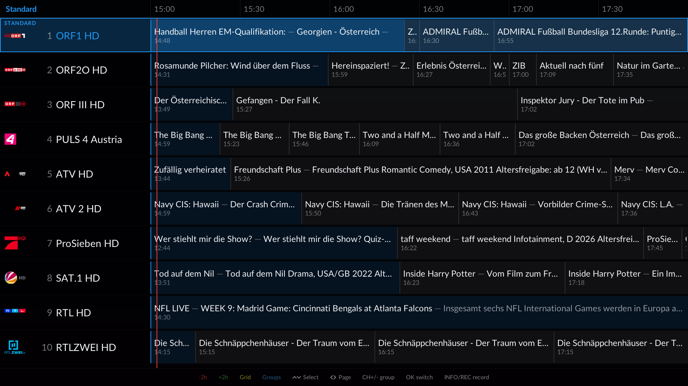
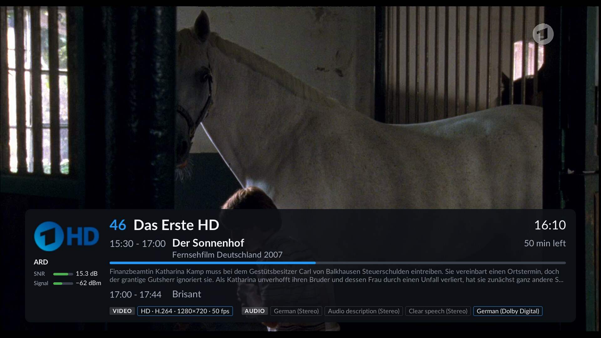
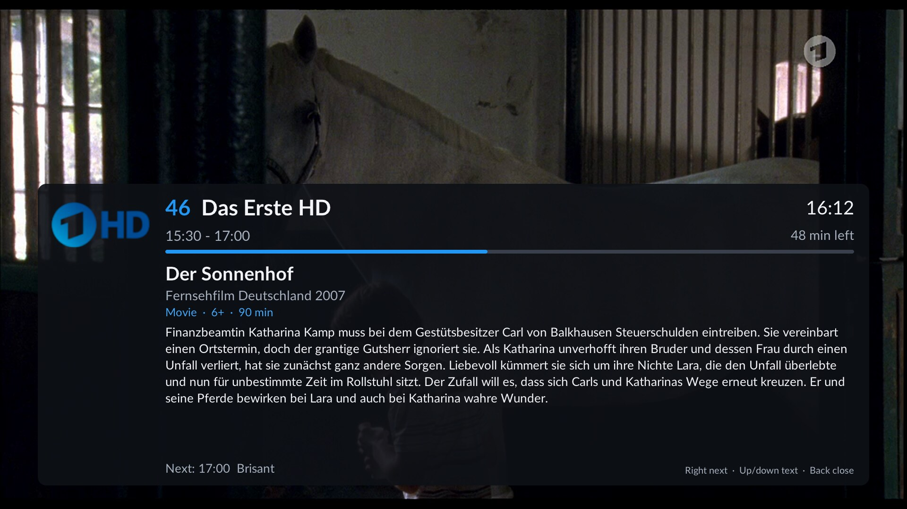
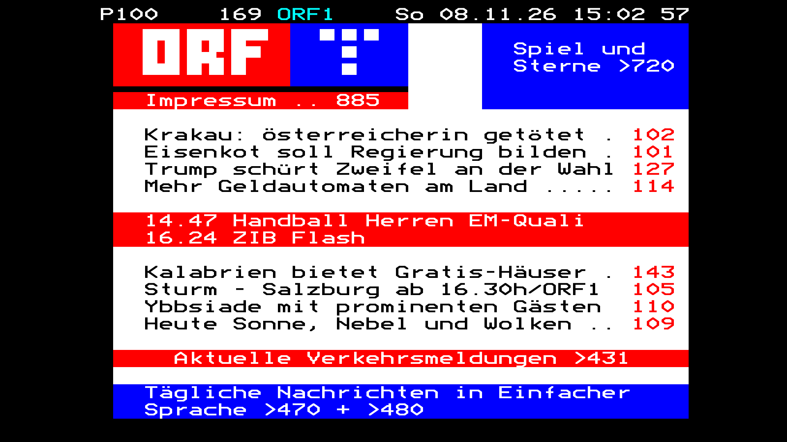
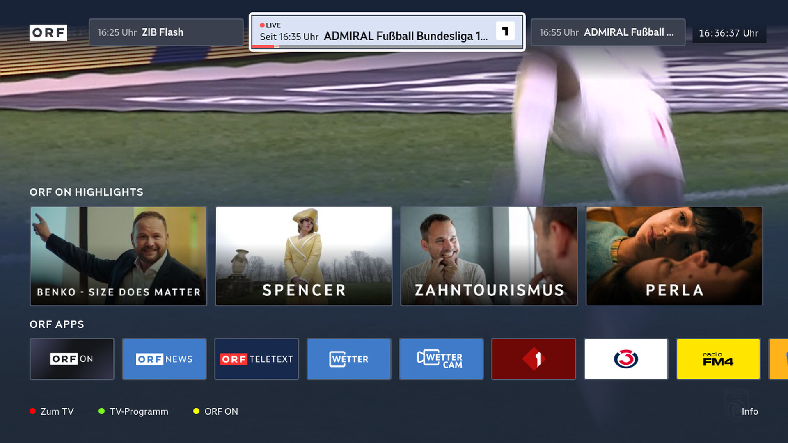

<h1 align="center">TVF – TV Frontend</h1>

A native <a href="https://tvheadend.org">TVheadend</a> client for LG webOS TVs. 
Live TV, programme guide, recordings, timeshift, teletext and HbbTV – with very fast channel switching.

## Features

- **Live TV** with channel banner (now/next, logo, audio and video details), channel groups,
  digits, previous channel.
- **Programme guide** as a time grid or now/next list, with programme details.
- **Timeshift**: pause, jump ±30 s, back to live (uses tvheadend's timeshift).
- **Recordings**: schedule from the guide (also series), browse, resume where you stopped.
- **Teletext**, teletext and DVB **subtitles**, audio track selection (remembered per channel).
- **HbbTV** (red button) in a built-in browser, as on a regular HbbTV TV.
- **Magic Remote**: pointer and scroll wheel, long-press actions.
- **Phone as remote**: works with the remote app Kore on iOS and Android – TVF shows up
  there by itself.
- Interface in English and German; more languages can be added with a small JSON file.

## Status

TVF is a **developer app**: it is installed through the webOS Developer Mode, not through the
LG Content Store, and it uses system services that LG does not document for third-party apps.
A firmware update can therefore break parts of it.

**Currently tested on the LG OLED G4 (OLED77G4, webOS 25 and 26) and the LG OLED C8 (OLED77C8,
webOS 4.4).** Other models and webOS versions are untested.

## What you need

- An LG webOS TV with Developer Mode.
- A PC with the [webOS CLI](https://webostv.developer.lge.com/develop/tools/cli-installation)
  (`ares-*` commands, needs Node.js).
- A **TVheadend 4.3 or newer** server and a tvheadend user for the TV.
- To build TVF yourself: a Linux PC with the webOS toolchain (see below).

## Install

### 1. Prepare the TV

1. On the TV open the LG Content Store and install the **Developer Mode** app (an LG developer
   account is needed once; see LG's
   [Developer Mode guide](https://webostv.developer.lge.com/develop/getting-started/developer-mode-app)).
2. Open the app, sign in and switch **Dev Mode Status** and **Key Server** on; the TV restarts.
   The app now shows the TV's IP address and passphrase. The session expires after a while (the
   app shows the remaining time) – open the app and extend it, otherwise developer apps are removed.
3. On the PC register the TV once (`tv` is a name of your choice):

       ares-setup-device --add tv -i "host=<TV IP>" -i "port=9922" -i "username=prisoner"
       ares-novacom --device tv --getkey        # asks for the passphrase shown on the TV
       ares-device-info -d tv                   # check

### 2. Get the app

Build the `.ipk` yourself (see "Build" below) or use one that somebody built for you.

### 3. Install and start

    ares-install -d tv com.lsd.tvf_<version>_arm.ipk
    ares-launch  -d tv com.lsd.tvf

Updating is the same `ares-install` again; your settings are kept.
After a firmware update of the TV (seen with webOS 25 → 26) TVF may hang at its start spinner or not
start at all: remove it with `ares-install -d tv -r com.lsd.tvf` and install it again. The settings
are stored outside the app and survive this.
`ares-launch` does not restart a running app – use `ares-launch -d tv --close com.lsd.tvf` first.

### 4. Connect to TVheadend

Create a tvheadend user for the TV (Configuration → Users → Access Entries and Passwords) with
rights for streaming and for the video recorder (names vary slightly between tvheadend versions).
For timeshift, enable it in tvheadend (Configuration → Recording → Timeshift).

TVF looks for tvheadend in the network at the first start (tvheadend announces itself via
mDNS/Avahi, so it needs a tvheadend built with Avahi and a running `avahi-daemon` on the server):
if it finds exactly one server, it takes it; otherwise the settings page opens to choose one or to
enter the address. If the server refuses the login, the settings page opens at the user field.

In TVF **hold the green key** (a long press) for the settings page: *Search for servers* (OK, then
left/right picks a server found), or enter the server address yourself, then user and password.
Press *Save and restart*.

### 5. HbbTV (optional)

HbbTV runs in a separate browser add-on package, `com.lsd.tvf.web` (large, ~120 MB), built from the
[wpe-webos](https://github.com/L-S-D/wpe-webos) project:

    ares-install -d tv com.lsd.tvf.web_<version>_all.ipk

Without it TVF works as usual, only the red button does nothing.

### 6. Faster channel switching (optional)

TVF works with a plain tvheadend. Our tvheadend fork adds *instant zapping*: tvheadend keeps chosen
muxes tuned and holds the last seconds of their whole transport stream in a ring buffer. Switching to
a channel on such a warm mux starts the stream at the last keyframe from the buffer instead of
waiting for the next one, and the picture comes up in about half a second (LG G4, satellite). TVF
needs no setting for it.

Use the branch [`v3/tvf`](https://github.com/L-S-D/tvheadend/tree/v3/tvf) of
[L-S-D/tvheadend](https://github.com/L-S-D/tvheadend): current upstream tvheadend, our open pull
requests (among them the HTSP extensions that save TVF its PMT lookup) and instant zapping. It builds
like tvheadend itself; instant zapping is compiled in unless you pass `--disable-dvbbuffer`. The
fork's `master` is `v3/all`, which adds further work on top (Neumo DVB driver, DAB, T2-MI).

In tvheadend:

- Mark the muxes to keep warm: Configuration → DVB Inputs → Muxes, *Prebuffer (instant zapping)*.
- Optionally keep the last watched muxes warm too: Configuration → Stream → Instant Zapping,
  *Recently used muxes kept warm* (0 = off).
- Every warm mux holds a tuner, with a low weight: recordings and viewers still get it when needed.

## Build

TVF is cross-compiled for the TV with the webOS buildroot toolchain.

1. Get the toolchain (`arm-webos-linux-gnueabi_sdk-buildroot`), for example from the
   [openlgtv/buildroot-nc4](https://github.com/openlgtv/buildroot-nc4/releases) releases. Unpack it to
   `/opt/webos-sdk/` and run its `relocate-sdk.sh` once. (Another location: set `WEBOS_SDK_PATH`.)
2. Install cmake (3.13 or newer) and git.
3. Build and package:

       git clone --recurse-submodules https://github.com/L-S-D/TVF.git
       cd TVF
       ./build.sh        # -> build/tvf
       ./package.sh      # -> com.lsd.tvf_<version>_arm.ipk

Optional settings (default server, build options, HbbTV network rules) are described in
[docs/DEVELOPMENT.md](docs/DEVELOPMENT.md).

## Using TVF

| Key | In live TV |
|---|---|
| CH+ / CH− or scroll wheel | Next / previous channel |
| Digits | Channel number; `0` = previous channel |
| OK | Show the channel banner; **hold** for the programme info |
| ↑ / ↓ or Back | Channel list and programme guide |
| ← / → | Timeshift: 30 s back / forward (pauses live TV) |
| Red | HbbTV |
| Green | Recordings; **hold** for the settings |
| Yellow | Audio track, sound offset and subtitles |
| Blue | Teletext |

In the programme guide **click a programme with the pointer** to record it (or to cancel a timer).
Red/green scroll the guide by two hours, yellow switches between grid and now/next list, blue shows the
channel groups. A phone with Kore can do the same and more (see below).

With *Key layout → HbbTV first* in the settings, a channel's HbbTV app starts by itself, like on an
HbbTV TV; the colour keys then belong to the app and TVF's functions move to long presses.

### Kore on your phone

Open Kore, add a host and pick **TVF** from the list (or enter the TV's IP address, port 8080).
You get the channels with now/next, the programme guide, recordings and timers; you can switch
channels, play and schedule recordings and use the remote pad. Name, ports and an optional password
are on TVF's settings page. If the TV is in standby, Kore can wake it up (the TV needs *Turn on via
Wi-Fi/LAN*).

### Settings

All settings are on the settings page (**hold green**): language, key layout, server address and
login, HbbTV network access and the Kore options. Changed values show in yellow; they are applied
with *Save and restart*.

## Troubleshooting

- **The app disappears from the TV**: the Developer Mode session ran out. Open the Developer Mode app
  and extend it, then install again if needed.
- **No channels or a message that the server cannot be reached**: hold green and check address, ports
  and login; the TV and the server must be on the same network. *Search for servers* finds a
  tvheadend that announces itself via Avahi (in Docker only with host networking).
- **Nothing happens after `ares-launch`**: the app is already running – close it first
  (`ares-launch -d tv --close com.lsd.tvf`).
- **A log without SSH**: `ares-launch -d tv com.lsd.tvf -p '{"log":"<PC IP>:5555"}'`, then on the PC
  `socat -u UDP-RECV:5555 -`.

## More

- [Developer notes](docs/DEVELOPMENT.md): build options, launch parameters, key details, settings,
  Kore interface, adding a language, testing without a remote, source layout, pitfalls.
- Third-party code, fonts and data: [THIRD_PARTY_NOTICES.md](THIRD_PARTY_NOTICES.md).

## Licence

TVF is free software under the **GNU General Public License, version 3 or (at your option) any later
version** – see [LICENSE](LICENSE). It is distributed in the hope that it will be useful, but
without any warranty.
